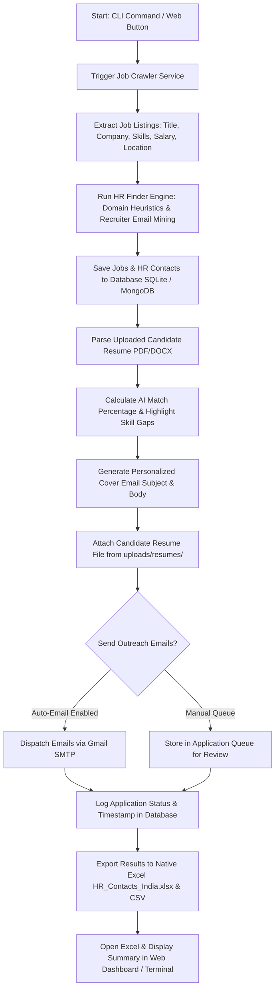

# 🚀 JobHunter AI — Autonomous Job Hunter & HR Outreach Platform

> **JobHunter AI** is an end-to-end autonomous job application engine and web platform designed to automate tech job discovery across India and global markets, extract direct HR/recruiter contact information, parse resumes, calculate match scores, personalize cold email outreach, attach candidate resumes, send applications automatically, and export leads to native Excel/CSV spreadsheets.

---

## 📋 Table of Contents
1. [Overview](#-overview)
2. [Key Features](#-key-features)
3. [System Architecture & Technology Stack](#-system-architecture--technology-stack)
4. [How the System Operates (Workflow)](#-how-the-system-operates-workflow)
5. [Directory Structure](#-directory-structure)
6. [Prerequisites & Setup](#-prerequisites--setup)
7. [How to Run](#-how-to-run)
   - [Option 1: 1-Click Batch / CLI Automation](#option-1-1-click-batch--cli-automation)
   - [Option 2: Web Dashboard (FastAPI + React)](#option-2-web-dashboard-fastapi--react)
8. [API Endpoints Reference](#-api-endpoints-reference)

---

## 🔍 Overview

Finding and applying to relevant job listings manually is time-consuming. **JobHunter AI** eliminates friction by providing:
- **Automation**: Search jobs, extract recruiter emails, and send personalized applications in one command or click.
- **Precision Matching**: Analyzes candidate resumes against job descriptions to provide match percentages, key missing skills, and recommendations.
- **Direct Recruiter Outreach**: Identifies recruiter contact details (`talent@swiggy.in`, `careers@razorpay.com`, `hr@zerodha.com`) rather than generic job board submission forms.
- **Spreadsheet Reports**: Exports scraped target jobs and recruiter contact details into styled native Excel (`HR_Contacts_India.xlsx`) and CSV files.
- **Interactive Web Dashboard**: Streamlined 3-tab modern UI for managing search filters, candidate profiles, resume uploads, application queues, and sent outreach tracking.

---

## ✨ Key Features

### 1. 🌐 Multi-Source Job Crawler (`backend/services/job_crawler.py`)
- Aggregates tech job openings across major Indian tech hubs (**Bangalore**, **Gurgaon/NCR**, **Mumbai**, **Hyderabad**, **Pune**, **Chennai**, **Remote India**) and international listings.
- Extracts company names, job titles, locations, salary ranges (LPA / ₹ per month), required skills, and full job descriptions.

### 2. 📧 Recruiter Contact Extraction (`backend/services/hr_finder.py`)
- Employs domain-heuristic regex search to extract direct recruiter emails and hiring manager contact profiles.
- Generates structured recruiter metadata including recipient name, email address, role, and company domain.

### 3. 📄 AI Resume Parser & Match Scoring (`backend/services/resume_parser.py` & `ai_matcher.py`)
- Extracts raw text from `.pdf` and `.docx` resume uploads.
- Parses skills, experience, education, projects, contact details, and certifications.
- Calculates job match scores (%) and highlights matching vs. missing skill gaps.

### 4. ✉️ Personalized Cold Email Generator & SMTP Mailer (`backend/services/email_generator.py` & `mailer.py`)
- Dynamically customizes cold outreach emails embedding candidate target role, experience, top skills, and key projects.
- Sends live emails via Gmail SMTP using Secure App Passwords.
- Automatically attaches candidate's uploaded PDF/DOCX resume file (`uploads/resumes/`).

### 5. 📊 Native Excel & CSV Exporter (`backend/services/excel_exporter.py`)
- Formats scraped job data and HR contact lists into native Excel workbooks (`.xlsx`) with custom styling, column widths, and headers.
- Automatically opens the generated spreadsheet upon completion of automated runs.

### 6. 💻 Ultra-Modern React Web Dashboard (`frontend/`)
- Built with React 18, TypeScript, and TailwindCSS.
- Features intuitive tabs:
  - 🔍 **Find Jobs & HRs**: Filter jobs, trigger crawlers, run automated HR extraction, and launch outreach.
  - 📄 **My Resume & Profile**: Manage candidate profile details, skills, and upload resumes.
  - ✉️ **Sent Outreach Emails**: Monitor application queue, email status, and delivery logs.

---

## 🛠 System Architecture & Technology Stack

```
                     ┌──────────────────────────────────────────┐
                     │         JobHunter AI Platform            │
                     └────────────────────┬─────────────────────┘
                                          │
        ┌─────────────────────────────────┴─────────────────────────────────┐
        │                                                                   │
┌───────▼────────┐                                                  ┌───────▼────────┐
│  React + Vite  │  ◄──────────── REST API / CORS ─────────────►    │    FastAPI     │
│   Frontend     │                                                  │    Backend     │
└────────────────┘                                                  └───────┬────────┘
                                                                            │
      ┌──────────────────────┬──────────────────────┬───────────────────────┼──────────────────────┐
      │                      │                      │                       │                      │
┌─────▼──────┐        ┌──────▼──────┐        ┌──────▼──────┐         ┌──────▼──────┐        ┌──────▼──────┐
│ SQLite DB  │        │ MongoDB     │        │ Job Crawler │         │  HR Finder  │        │ SMTP Mailer │
│(models.py) │        │(mongo_db.py)│        │  Services   │         │  & Exporter │        │  (Gmail)    │
└────────────┘        └─────────────┘        └─────────────┘         └─────────────┘        └─────────────┘
```

### Stack Components:
- **Backend Framework**: Python 3.10+, FastAPI, Uvicorn
- **Databases**: SQLite via SQLAlchemy (`jobhunter.db`) & PyMongo / MongoDB fallback (`mongo_db.py`)
- **Web Scraping & Extraction**: BeautifulSoup4, Requests, Regex heuristics
- **Spreadsheet Processing**: OpenPyXL, Pandas
- **Frontend Framework**: React 18, Vite, TypeScript, TailwindCSS, Lucide Icons, Axios
- **Automation / Scripting**: Python `subprocess`, Windows `.bat` batch launcher

---

## 🔄 How the System Operates (Workflow)



### Detailed Operational Steps:
1. **Triggering Search**: The user enters a target role (e.g. `"Full Stack Developer"`) and location (e.g. `"Bangalore"`) via CLI argument or Web UI.
2. **Scraping Tech Feeds**: `job_crawler.py` and `india_job_scraper.py` fetch live job posts across target cities.
3. **Extracting HR Details**: `hr_finder.py` derives recruiter contact emails using domain matching and talent acquisition patterns.
4. **Matching & Resume Processing**: `resume_parser.py` parses candidate skills from stored resume documents, while `ai_matcher.py` computes compatibility scores.
5. **Personalized Email Generation**: `email_generator.py` injects target job details, company names, and applicant experience into tailored email bodies.
6. **Sending & Attachment**: `mailer.py` logs into SMTP (Gmail) and transmits email messages with attached PDF/DOCX resumes.
7. **Reporting & Excel Output**: `excel_exporter.py` writes structured job details and email status into `HR_Contacts_India.xlsx` and opens the file automatically.

---

## 📁 Directory Structure

```
d:\Job Finder\
├── api/                       # Deployment API entries (e.g. Vercel serverless entry)
│   └── index.py
├── backend/                   # FastAPI Server, Services, & Database
│   ├── main.py                # Primary FastAPI application endpoints & routes
│   ├── database.py            # SQLite SQLAlchemy connection setup
│   ├── models.py              # Database schemas (Users, Profiles, Jobs, Applications)
│   ├── mongo_db.py            # MongoDB handler & operations
│   ├── requirements.txt       # Python dependencies
│   ├── jobhunter.db           # SQLite database file
│   ├── HR_Contacts_India.xlsx # Generated Excel report
│   ├── HR_Contacts_India.csv  # Generated CSV report
│   ├── scripts/               # Automation & Scraper scripts
│   │   └── india_job_scraper.py
│   └── services/              # Business logic modules
│       ├── ai_matcher.py      # Skill match calculation algorithm
│       ├── email_generator.py # Personalized email template generator
│       ├── excel_exporter.py  # OpenPyXL Excel & CSV formatting service
│       ├── hr_finder.py       # HR recruiter email extractor
│       ├── job_crawler.py     # Tech job scraper service
│       ├── mailer.py          # SMTP email transmission service
│       └── resume_parser.py   # PDF / DOCX resume parsing utility
├── frontend/                  # React + TypeScript + Vite UI
│   ├── package.json           # Frontend dependencies & scripts
│   ├── vite.config.ts         # Vite bundler configuration
│   ├── tailwind.config.js     # Tailwind CSS styles config
│   └── src/
│       ├── App.tsx            # Main application layout & tab routing
│       ├── components/        # UI Views & Components
│       │   ├── JobSearchView.tsx        # Search & scrape jobs view
│       │   ├── HROverviewTable.tsx      # HR Contacts table view
│       │   ├── ApplicationQueueView.tsx # Outreach tracking view
│       │   ├── ResumeProfileView.tsx    # Resume upload & skills profile
│       │   ├── AnalyticsView.tsx        # Application stats & metrics
│       │   ├── SettingsView.tsx         # SMTP & API key settings
│       │   ├── AdminView.tsx            # System administration view
│       │   └── ...                      # Modals & Navigation components
│       └── services/          # Frontend API integration services
├── run_auto_job_hunter.py     # Python 1-click execution entry script
├── run_auto_job_hunter.bat    # Windows 1-click batch launcher
├── vercel.json                # Vercel deployment configuration
├── work_to_be_done_tomorrow.md# Daily checklist & setup instructions
└── README.md                  # Comprehensive Project Documentation
```

---

## ⚙️ Prerequisites & Setup

### 1. Software Prerequisites
- **Python 3.10+**
- **Node.js 18+** & `npm`
- **Microsoft Excel** or any spreadsheet viewer (optional, to view exported `.xlsx` files)

### 2. Configure Environment Variables (`backend/.env`)
Create or edit `backend/.env`:
```env
# Gmail SMTP Credentials (For automated cold email outreach)
GMAIL_USER=your_email@gmail.com
GMAIL_APP_PASSWORD=abcd efgh ijkl mnop   # 16-character Gmail App Password

# Optional MongoDB URI (defaults to SQLite if unconfigured)
MONGODB_URI=mongodb://localhost:27017/jobhunter
```

> 💡 **Note on Gmail App Passwords**:
> 1. Go to [Google Account Security](https://myaccount.google.com/security).
> 2. Ensure **2-Step Verification** is turned ON.
> 3. Search for **App passwords**, enter `JobHunter AI`, and generate your 16-character app password.

---

## 🚀 How to Run

### Option 1: 1-Click Batch / CLI Automation

To run autonomous job scraping, HR extraction, Excel export, and auto-email outreach in a single step:

#### **Windows Batch Launcher**:
Double-click `run_auto_job_hunter.bat` in the root folder, or run:
```cmd
run_auto_job_hunter.bat
```

#### **Terminal Command**:
Run from the root directory:
```bash
python run_auto_job_hunter.py "Full Stack Developer" "Bangalore"
```
*You can customize the parameters for any role or location:*
```bash
python run_auto_job_hunter.py "Backend Engineer" "Remote"
```

---

### Option 2: Web Dashboard (FastAPI + React)

#### Step 1: Start Backend Server
```bash
cd backend
pip install -r requirements.txt
python -m uvicorn main:app --reload --port 8000
```
*The FastAPI backend will run on `http://localhost:8000` with interactive API docs at `http://localhost:8000/docs`.*

#### Step 2: Start Frontend Dev Server
```bash
cd frontend
npm install
npm run dev
```
*Open `http://localhost:5173` in your browser to access the Web Dashboard.*

---

## 📡 API Endpoints Reference

| Method | Endpoint | Description |
| :--- | :--- | :--- |
| `GET` | `/` | Health check — returns `{"status": "online"}` |
| `POST` | `/api/auth/signup` | Register new user account |
| `POST` | `/api/auth/login` | Login, returns user + profile |
| `GET` | `/api/jobs` | List jobs with optional filters (query, work_type, job_type, min_match) |
| `POST` | `/api/jobs/scrape` | Trigger crawler for keyword + location |
| `GET` | `/api/jobs/export/excel` | Download `HR_Contacts_Jobs_India.xlsx` |
| `GET` | `/api/jobs/export/csv` | Download `HR_Contacts_Jobs_India.csv` |
| `POST` | `/api/resume/upload` | Upload PDF/DOCX resume, parse and store |
| `GET` | `/api/profile` | Get candidate profile |
| `POST` | `/api/profile` | Update candidate profile |
| `POST` | `/api/applications/apply/{job_id}` | Send one application email to recruiter |
| `POST` | `/api/applications/bulk-auto-send` | Bulk send emails to all unapplied jobs |
| `GET` | `/api/applications` | List all applications for user |
| `PATCH` | `/api/applications/{id}/status` | Update application status |
| `GET` | `/api/dashboard/stats` | Dashboard analytics summary |
| `GET` | `/api/settings` | Get SMTP + search settings |
| `POST` | `/api/settings` | Update SMTP + search settings |

---

## 🚀 Deployment Guide (Production)

The project uses a **split deployment**:
- **Frontend** (React/Vite) → **Vercel** (free, CDN-backed)
- **Backend** (FastAPI) → **Render.com** (free tier, Python ASGI)

---

### Step 1 — Push to GitHub

```bash
git init
git add .
git commit -m "Initial commit"
git remote add origin https://github.com/your-username/jobhunter-ai.git
git push -u origin main
```

> **Note**: The `.gitignore` will automatically exclude `.env`, `*.db`, `node_modules/`, and `dist/` — your MongoDB credentials are safe.

---

### Step 2 — Deploy Backend to Render

1. Go to [render.com](https://render.com) → **New → Web Service**
2. Connect your GitHub repo
3. Set **Root Directory** to `backend`
4. Render detects `render.yaml` automatically. Confirm these settings:
   - **Build Command**: `pip install -r requirements.txt`
   - **Start Command**: `uvicorn main:app --host 0.0.0.0 --port $PORT`
   - **Runtime**: Python 3.11
5. In **Environment Variables**, add:

   | Key | Value |
   |---|---|
   | `MONGODB_URI` | `mongodb+srv://...` (your Atlas URI) |
   | `MONGODB_DB_NAME` | `jobhunter` |
   | `GMAIL_USER` | `your_email@gmail.com` |
   | `GMAIL_APP_PASSWORD` | `xxxx xxxx xxxx xxxx` (16-char app password) |

6. Click **Deploy** → wait ~2 min → copy your URL, e.g. `https://jobhunter-api.onrender.com`

> 💡 **Gmail App Password**: Go to [Google Account Security](https://myaccount.google.com/security) → enable 2-Step Verification → search **App passwords** → generate for `JobHunter AI`.

---

### Step 3 — Deploy Frontend to Vercel

1. Go to [vercel.com](https://vercel.com) → **New Project** → import your GitHub repo
2. Set **Root Directory** to `frontend`
3. Vercel auto-detects Vite. Confirm:
   - **Framework Preset**: Vite
   - **Build Command**: `npm run build`
   - **Output Directory**: `dist`
4. In **Environment Variables**, add:

   | Key | Value |
   |---|---|
   | `VITE_API_URL` | `https://jobhunter-api.onrender.com` |

5. Click **Deploy** → your frontend is live on `https://your-project.vercel.app`

---

### Step 4 — Set Gmail Credentials in the Web UI (Alternative to Env Vars)

If you don't want to set env vars on Render, you can enter Gmail credentials directly in the app:
1. Open the deployed frontend URL
2. Go to **Settings** tab
3. Enter your Gmail address and 16-character App Password
4. Click **Save Settings** — they're stored in the database and used for all future emails

---

## 🛡 License & Disclaimer

*This project is built for professional automated job searching and educational purposes. Ensure compliance with email outreach guidelines and job board terms of service when running mass crawlers or automated mailers.*

